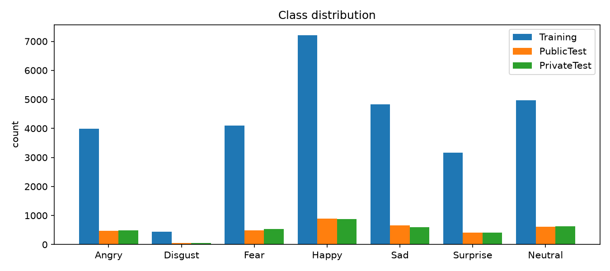
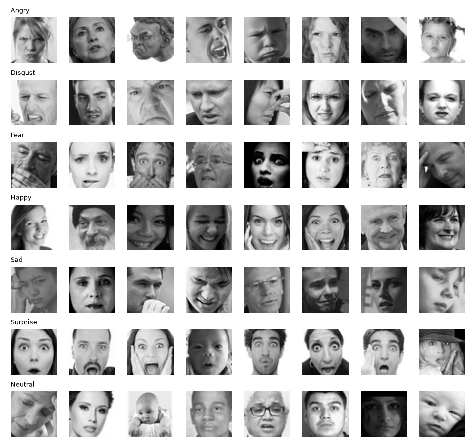

# 数据检查报告

- ✅ Training: 28709 张（应为 28709）
- ✅ PublicTest: 3589 张（应为 3589）
- ✅ PrivateTest: 3589 张（应为 3589）
- ✅ Usage 取值: ['PrivateTest', 'PublicTest', 'Training']
- ✅ 标签范围 0~6
- ✅ 图像尺寸 (48, 48)
- ✅ Training MEAN=0.5077 STD=0.2550（dataset.py 中为 0.5077/0.255）
- ℹ️ 几乎纯色的空白图：13 张
- ℹ️ PublicTest 中与 Training 像素完全相同的图：280 张
- ℹ️ PrivateTest 中与 Training 像素完全相同的图：288 张

## 类别分布

| 类别 | Training | PublicTest | PrivateTest |
|---|---|---|---|
| 0 Angry | 3995 | 467 | 491 |
| 1 Disgust | 436 | 56 | 55 |
| 2 Fear | 4097 | 496 | 528 |
| 3 Happy | 7215 | 895 | 879 |
| 4 Sad | 4830 | 653 | 594 |
| 5 Surprise | 3171 | 415 | 416 |
| 6 Neutral | 4965 | 607 | 626 |

